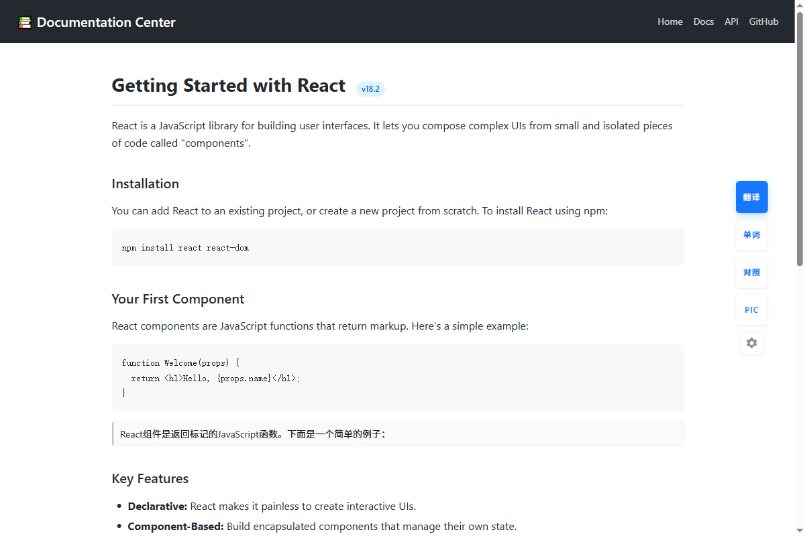
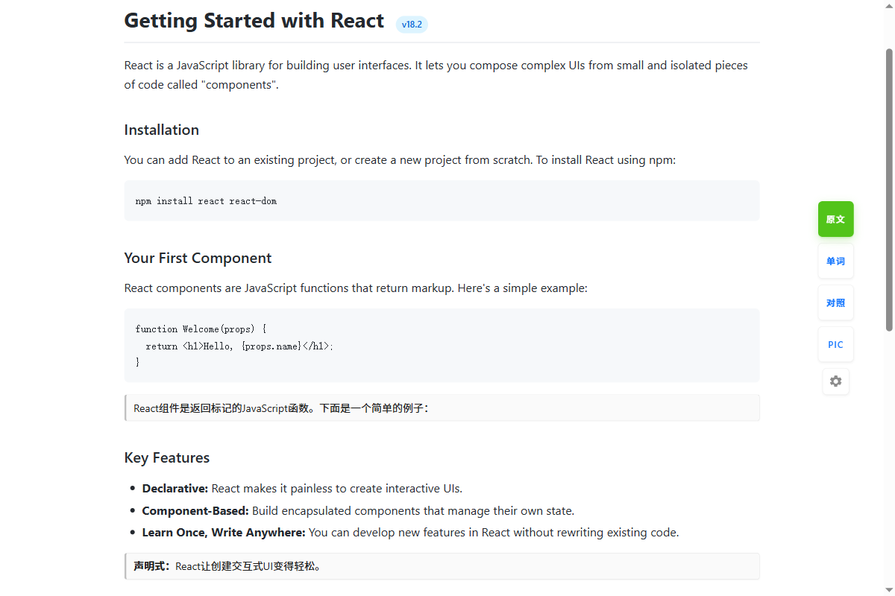
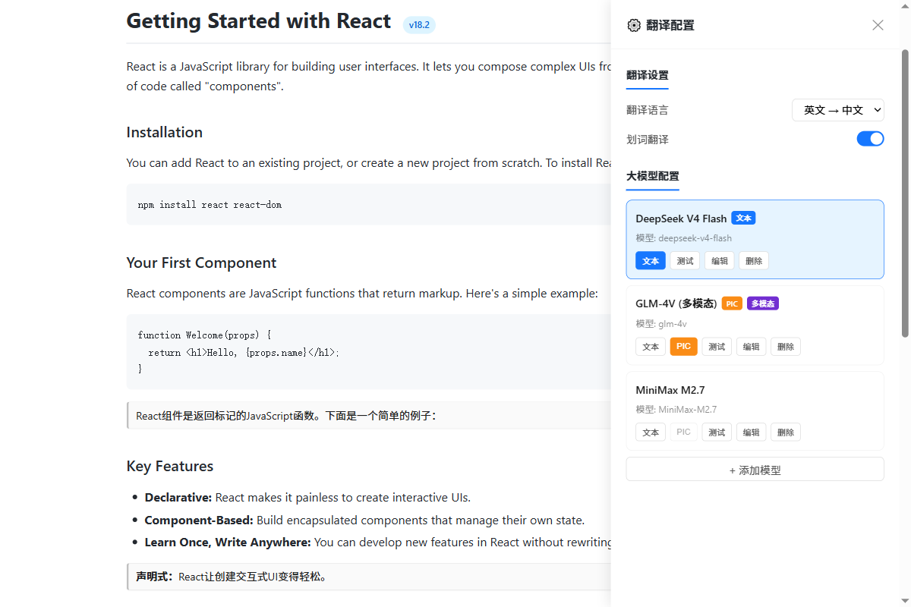
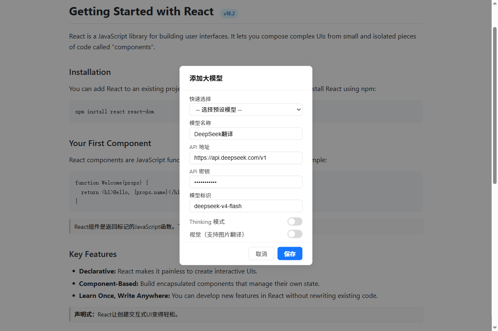
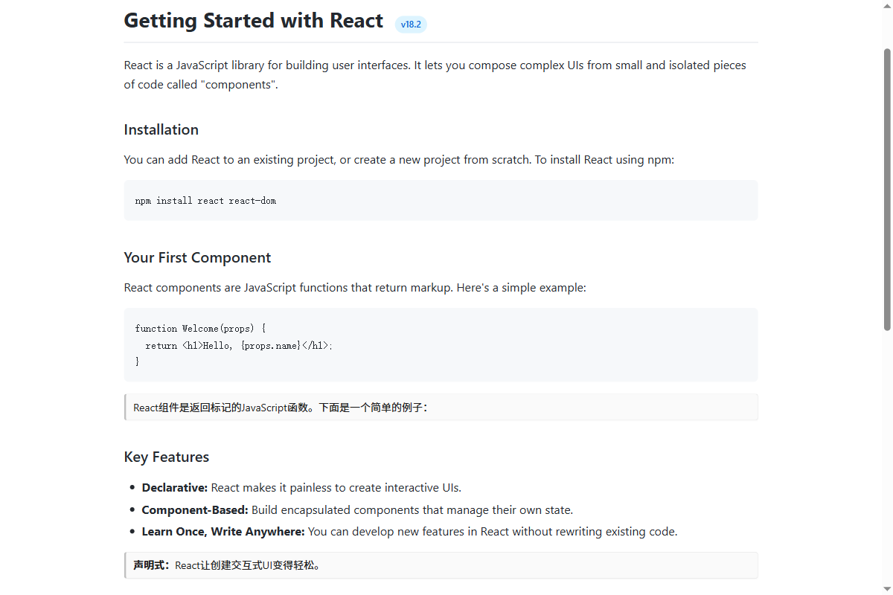
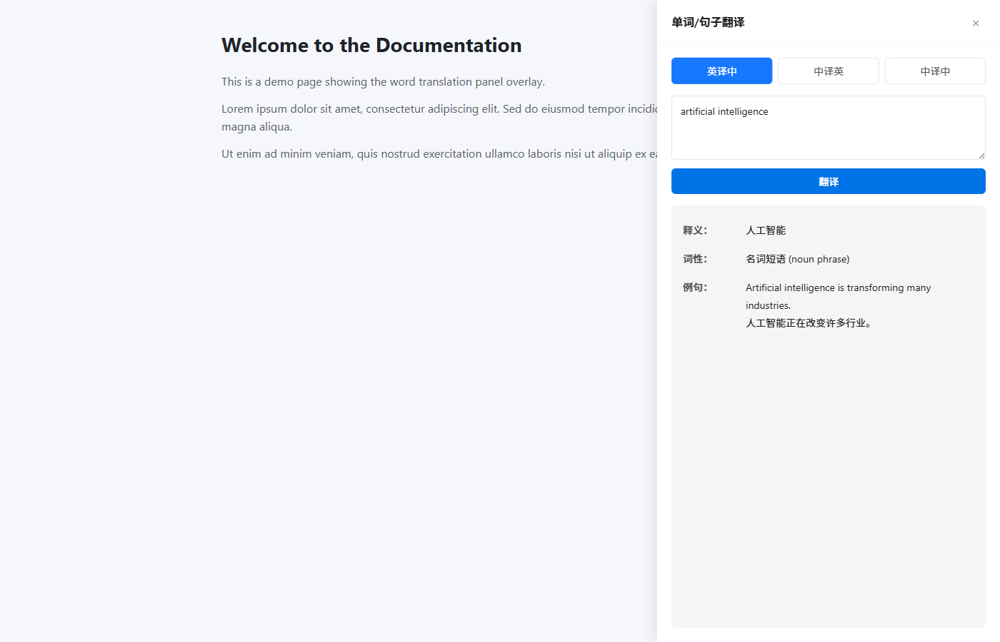
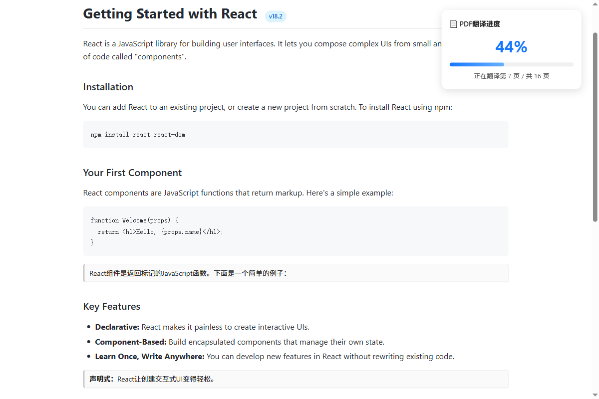

# translator-plugs — Chrome 网页翻译插件

**中文** | [English](./README_EN.md)

> 使用大模型（DeepSeek / 智谱GLM / 火山引擎 / MiniMax / OpenAI 等）将英文网页翻译成中文，支持对照翻译、划词翻译、单词查询、扫描版 PDF 图片翻译，并内置版本更新自动检查。

> 完整版本变更记录见 [CHANGELOG.md](./CHANGELOG.md)。

---

## 目录

- [一、快速开始（安装教程）](#一快速开始安装教程)
- [二、功能预览](#二功能预览)
- [三、功能按钮一览](#三功能按钮一览)
- [四、配置大模型（保姆级教程）](#四配置大模型保姆级教程)
- [五、核心功能详解](#五核心功能详解)
- [六、使用场景示例](#六使用场景示例)
- [七、项目架构](#七项目架构)
- [八、特色功能深入讲解](#八特色功能深入讲解)
- [九、注意事项与常见问题](#九注意事项与常见问题)

---

## 一、快速开始（安装教程）

### 1.1 什么是 Chrome 插件？

Chrome 插件是运行在 Chrome 浏览器中的小程序，可以增强浏览器的功能。本插件的作用是：**在你浏览任何网页时，右侧会出现一个翻译浮动面板，点击即可翻译。**

### 1.2 安装步骤

**前提条件**：你需要一个 Chrome 内核浏览器（Chrome、Edge、360极速浏览器、Brave 等均可）。

1. **下载项目文件**

   将整个 `translator-plugs` 文件夹下载到本地任意位置，例如 `D:\source\translator-plugs`。

2. **打开浏览器的扩展管理页面**

   - Chrome：地址栏输入 `chrome://extensions/` 回车
   - Edge：地址栏输入 `edge://extensions/` 回车

3. **开启「开发者模式」**

   在扩展管理页面的右上角，找到「开发者模式」开关，打开它。

4. **加载已解压的扩展程序**

   点击左上角的「加载已解压的扩展程序」按钮，选择 `translator-plugs` 文件夹。

5. **安装成功**

   你会在扩展列表中看到「translator-plugs」。此时打开任意网页，页面右侧会出现翻译浮动面板。

> **提示**：如果修改了代码，需要在扩展管理页面点击「重新加载」按钮，然后刷新网页才能生效。

---

## 二、功能预览


*图：网页右侧浮动面板，鼠标悬停后展开所有功能按钮*


*图：翻译完成后的面板状态，顶部按钮变为绿色「原文」，可一键恢复；下方为对照译文卡片*

---

## 三、功能按钮一览

在网页右侧的浮动面板上，鼠标悬停后会展开以下按钮（从上到下）：

```
┌──────┐
│ 翻译 │  ← 蓝色大按钮，翻译整个页面（英文→中文）
├──────┤
│ 单词 │  ← 单词/句子翻译，手动输入要翻译的内容
├──────┤
│ 对照 │  ← 对照翻译，原文下方紧跟着译文
├──────┤
│ PIC  │  ← 图片/扫描版PDF翻译（需要多模态大模型）
├──────┤
│ ⚙️  │  ← 配置面板，管理大模型
└──────┘
```

**按钮状态说明**：

| 按钮状态 | 含义 |
|---------|------|
| 蓝色「翻译」 | 初始状态，点击开始翻译 |
| 绿色「原文」 | 翻译完成，点击恢复原文 |
| 灰色「翻译中」 | 正在翻译，请等待 |
| 绿色「对照中」 | 对照翻译进行中或已完成 |
| 红色「取消」 | PIC翻译进行中，点击可取消 |
| 红色脉冲圆点 | 检测到新版本（右下角），点击打开配置面板查看更新日志 |

> 浮动面板支持按住左键拖动到页面其他位置；拖动后「翻译」「单词」「对照」「PIC」「⚙️」按钮仍可正常点击。

---

## 四、配置大模型（保姆级教程）

> 插件本身不自带翻译能力，需要你配置一个大模型的 API。可以理解为：插件是"遥控器"，大模型是"发动机"，你需要自己提供发动机。

### 4.1 如何获取 API Key？

以 DeepSeek 为例（推荐新手使用，便宜且翻译质量好）：

1. 访问 [DeepSeek 开放平台](https://platform.deepseek.com/)
2. 注册账号并登录
3. 进入「API Keys」页面，点击「创建 API Key」
4. 复制生成的 Key（形如 `sk-xxxxxxxxxxxx`），**这个 Key 只显示一次，请妥善保存**

其他模型获取方式类似：
| 模型 | 获取地址 | 备注 |
|------|---------|------|
| DeepSeek | https://platform.deepseek.com/ | 推荐，性价比高 |
| 智谱 GLM | https://open.bigmodel.cn/ | 国产，支持多模态 |
| 火山引擎 | https://www.volcengine.com/ | 字节跳动旗下 |
| MiniMax | https://platform.minimax.chat/ | 支持多模态 |
| OpenAI | https://platform.openai.com/ | 需要海外网络 |

### 4.2 在插件中配置模型

1. **打开配置面板**：点击浮动面板上的 ⚙️ 齿轮图标


*图：配置面板，包含翻译设置、大模型列表管理*

2. **添加模型**：点击「+ 添加模型」按钮


*图：添加大模型弹窗，可快速选择预设模型*

3. **填写模型信息**：

   ```
   快速选择：下拉选择预设模型（推荐，会自动填充下面三项）
   
   模型名称：显示用，随意填，如 "DeepSeek翻译"
   API 地址：https://api.deepseek.com/v1 （预设会自动填）
   API 密钥：sk-xxxxxxxxxxxxxxxxxx （粘贴你获取的 Key）
   模型标识：deepseek-v4-flash （预设会自动填）
   ```

4. **开关说明**：

   - **Thinking 模式**：开启后大模型会"深度思考"再翻译，质量略高但速度更慢。一般关闭即可。
   - **视觉（支持图片翻译）**：开启后该模型可用于 PIC 按钮翻译图片/PDF。只有支持多模态的模型才能开启（如 GLM-4V、GPT-4o 等）。

5. **保存**：点击「保存」按钮

6. **设为默认**：在模型列表中，点击「默认文本」按钮，将该模型设为翻译按钮的默认模型；点击「默认PIC」把它设为图片翻译的默认模型（再次点击可取消默认）

7. **测试模型**：点击「测试」按钮，验证配置是否正确，如果返回翻译结果说明配置成功；也可以点击「测试全部」一次性验证所有模型。

### 4.3 双默认模型机制

本插件有**两种默认模型**，可以设置为同一个模型，也可以设为不同的模型：

| 默认类型 | 用途 | 蓝色徽章标识 |
|---------|------|------------|
| 默认文本 | 「翻译」「对照」「单词」「划词」 | `文本` 蓝色 |
| 默认 PIC | 「PIC」按钮的图片/PDF翻译 | `PIC` 橙色 |

**为什么要分两种？** 多模态模型通常比纯文本模型慢很多。如果你用多模态模型翻译普通文本，速度会很慢。分开设置后，普通翻译用快速文本模型，图片翻译用多模态模型，各取所长。

> **提示**：只有开启了「视觉」开关的模型才能设为 PIC 默认。

---

## 五、核心功能详解

### 5.1 页面翻译（「翻译」按钮）

**用途**：将整个网页的英文内容替换为中文。

**工作流程**：
1. 点击「翻译」按钮
2. 插件自动收集网页中所有英文文本节点，并按顺序打上 `data-translator-id` 索引
3. 智能过滤：跳过代码块、JSON、纯数字、UI按钮文字（如 "OK"、"Login"）
4. 分批交给大模型翻译（每批 30 条，3 条并发），通过长连接流式接收结果
5. 每批翻译完成后做覆盖率复检；若模型漏返回部分条目，自动对缺失子集重试（最多 2 次）
6. 将翻译结果替换原文，按钮变绿显示「原文」
7. 再次点击恢复英文原文

**翻译方向**：
- 英文 → 中文（默认）
- 中文 → 英文（在扩展弹窗或浮动面板的「⚙️ 配置面板」中切换）

### 5.2 对照翻译（「对照」按钮）

**用途**：不修改原文，在每段英文下方插入中文译文，方便对照阅读。


*图：对照翻译模式，原文下方显示灰色译文卡片*

**特点**：
- 译文卡片有灰色左侧线，紧凑显示在原文下方
- 不破坏页面DOM结构，译文放在浮动层中
- 表格/列表中自动使用紧凑模式
- 支持取消（再次点击「对照」按钮）

### 5.3 单词翻译（「单词」按钮）

**用途**：手动输入单词或句子进行翻译，不依赖页面内容。


*图：单词/句子翻译面板，支持英译中、中译英、中译中三种模式*

**使用方法**：
1. 点击「单词」按钮打开输入面板
2. 在输入框中输入要翻译的内容
3. 按回车或点击翻译按钮
4. 译文显示在下方

**模式**：英译中 / 中译英 / 中译中三种模式。其中单个汉字在英文中没有对应单词，插件使用专用提示词并检测「模板复读」（模型只回显模板未真正翻译）后自动重试一次。

### 5.4 划词翻译

**用途**：选中网页中的文字，自动弹出翻译按钮。

**使用方法**：
1. 用鼠标选中网页中的一段文字
2. 选中文字附近会弹出一个小「翻译」按钮
3. 点击按钮即可翻译选中的文字

**方向自动识别**：插件会比较选区中拉丁字母与汉字的数量，自动判定是「英译中」还是「中译英」，无需手动切换。

**开关**：在扩展弹窗（点击浏览器工具栏的插件图标）或浮动面板的「⚙️ 配置面板」中可以开关划词翻译功能。

### 5.5 PIC 图片/PDF 翻译（「PIC」按钮）

**用途**：翻译扫描版 PDF 或网页中的图片内容。这是本插件的特色功能。

**适用场景**：
- 在线扫描版 PDF（如合同、报告、扫描文档）
- react-pdf 渲染的 Canvas 页面
- 页面中的图片（未来扩展）

**工作原理**：
1. 检测页面中的 Canvas 元素（PDF 渲染页面）
2. 判断是否为扫描版（检查 textLayer 是否为空）
3. 将每页 Canvas 转为 JPEG 图片
4. 发送给多模态大模型（如 GLM-4V、GPT-4o）进行 OCR + 翻译
5. 在每页 PDF 下方显示译文卡片（支持 Markdown 渲染）
6. 右上角显示醒目的进度面板（百分比 + 当前页/总页数）


*图：PIC翻译进度面板，实时显示百分比和当前页状态*

**使用前提**：
- 必须配置一个开启了「视觉」开关的大模型
- 必须将该模型设为「PIC 默认」或任意多模态模型（自动回退）

---

## 六、使用场景示例

### 场景 1：阅读英文技术文档

1. 打开一个英文文档页面（如 React 官方文档）
2. 点击「翻译」→ 整个页面变中文
3. 阅读完毕点击「原文」→ 恢复英文

### 场景 2：对照阅读长篇文章

1. 打开英文文章
2. 点击「对照」→ 每段英文下方出现中文译文
3. 对照阅读，理解更准确
4. 阅读完毕点击「对照」→ 移除译文

### 场景 3：翻译扫描版 PDF 合同

1. 打开在线 PDF（如 WorldFirst 的合同页面）
2. 确保已配置多模态模型（如 GLM-4V）并设为 PIC 默认
3. 点击「PIC」按钮
4. 右上角出现进度面板，显示"正在翻译第 N 页..."
5. 翻译完成后，每页 PDF 下方出现译文卡片
6. 如需取消，再次点击「取消」按钮

### 场景 4：快速翻译不认识的单词

1. 双击选中网页中的单词（或鼠标拖选）
2. 弹出翻译按钮，点击翻译
3. 或者点击「单词」按钮，手动输入翻译

### 场景 5：中文翻译成英文

1. 点击浏览器工具栏的插件图标
2. 在「翻译语言」下拉框中选择「中文 → 英文」
3. 点击「确认」保存
4. 打开中文网页，点击「翻译」→ 变成英文

---

## 七、项目架构

### 7.1 文件结构

```
translator-plugs/
├── manifest.json      ← 插件配置文件（MV3 格式）
├── content.js         ← 内容脚本（核心逻辑，注入到网页中）
├── background.js      ← 后台服务工作者（API 请求、流式翻译、版本更新检查）
├── popup.html         ← 扩展弹窗页面（点击工具栏图标弹出）
├── popup.js           ← 弹窗交互逻辑
├── style.css          ← 注入网页的样式文件
├── icon16.png         ← 工具栏图标（16x16）
├── icon48.png         ← 管理页面图标（48x48）
├── icon128.png        ← 商店图标（128x128）
├── screenshots/       ← 文档引用的功能截图
├── CHANGELOG.md       ← 版本更新日志
├── README.md          ← 中文说明文档
├── README_EN.md       ← 英文说明文档
└── LICENSE            ← 开源许可证
```

### 7.2 技术栈

| 技术 | 用途 |
|------|------|
| Chrome Extension MV3 | 插件架构标准 |
| 原生 JavaScript | 无框架依赖，纯 JS 实现 |
| Chrome Storage API | 持久化存储模型配置、翻译设置与更新状态 |
| Chrome Messaging API | content ↔ background 通信（一次性消息） |
| Chrome Port 长连接 | 流式翻译（`chrome.runtime.connect` + SSE 增量返回） |
| Chrome Alarms API | 每 24 小时定时检查 GitHub Release（service worker 被回收后仍生效） |
| Chrome Notifications API | 发现新版本时弹出桌面通知 |
| OpenAI 兼容 API | 大模型调用接口（兼容所有 OpenAI 格式的 API） |

### 7.3 架构图

```
┌─────────────────────────────────────────────────┐
│                   网页 (Web Page)                │
│                                                  │
│  ┌─────────────┐     ┌──────────────────────┐  │
│  │  content.js │     │     style.css         │  │
│  │             │     │  (注入的样式)          │  │
│  │ · 浮动面板   │     │  · 按钮样式            │  │
│  │ · 配置面板   │     │  · 翻译卡片样式        │  │
│  │ · 翻译逻辑   │     │  · 弹窗样式            │  │
│  │ · 文本收集   │     └──────────────────────┘  │
│  │ · DOM 操作   │                               │
│  └──────┬──────┘                               │
│         │ sendMessage：配置 / 查词 / PIC 翻译    │
│         │ connect('translateStream')：流式翻译   │
└─────────┼───────────────────────────────────────┘
          │
          ▼
┌─────────────────────────────────────────────────┐
│              background.js (Service Worker)      │
│                                                  │
│  · 接收翻译请求（含流式长连接）                    │
│  · 调用大模型 API (fetch / SSE)                   │
│  · 超时控制 (默认 120 秒，可配置 30–600 秒)        │
│  · 版本更新检查 (chrome.alarms 每 24 小时)         │
│  · 配置面板锁 (多窗口并发安全)                     │
│  · 消息类型: translateText / lookupText /        │
│    translateMultimodal / testModel / getConfig / │
│    saveConfig / getDefaultModel / 配置锁 / 更新    │
└─────────────────────────────────────────────────┘
          │
          ▼
┌─────────────────────────────────────────────────┐
│              popup.html / popup.js               │
│           (扩展弹窗 - 独立页面)                    │
│                                                  │
│  · 翻译方向切换 (英→中 / 中→英)                   │
│  · 超时时间设置                                    │
│  · 划词翻译开关                                    │
│  · 大模型配置 (添加/编辑/删除/测试)                 │
└─────────────────────────────────────────────────┘
```

### 7.4 数据流

**页面翻译流程**：

```
用户点击「翻译」
    ↓
content.js 收集网页文本节点（按序打上 data-translator-id）
    ↓
过滤（跳过代码、中文、UI文字等）
    ↓
分批（每批 30 条，3 条并发）
    ↓
chrome.runtime.connect({ name: 'translateStream' }) 长连接
    ↓
background.js 流式调用大模型 API（SSE 增量返回）
    ↓
按索引回填译文 → 覆盖率复检 → 缺失子集重试（最多 2 次）
    ↓
替换原文（写入前解码模型回显的字面转义） / 插入译文卡片
```

**PIC 翻译流程**：

```
用户点击「PIC」
    ↓
content.js 检测页面 Canvas (PDF页面)
    ↓
判断是否扫描版 (textLayer 为空)
    ↓
逐页: Canvas → JPEG Base64
    ↓
chrome.runtime.sendMessage → background.js
    ↓
background.js 调用多模态 API (Vision)
    ↓
返回译文 → content.js
    ↓
在 Canvas 下方插入译文卡片 (Markdown渲染)
    ↓
更新进度面板 (百分比 + 当前页)
```

---

## 八、特色功能深入讲解

### 8.1 智能文本过滤

插件不会盲目翻译所有文字，而是智能过滤：

| 过滤类型 | 示例 | 原因 |
|---------|------|------|
| 代码块 | `function foo() {}` | 代码不应翻译 |
| JSON 数据 | `{"name": "test"}` | 数据结构不应翻译 |
| 纯数字/日期 | `2024-01-01` | 无需翻译 |
| 已是中文 | `你好世界` | 中文内容跳过 |
| UI按钮文字 | `OK`, `Login`, `Submit` | 常见UI文字不翻译 |
| GitHub错误弹窗 | `Something went wrong` | 隐藏模板，不需要翻译 |
| 版本号 | `v1.2.3` | 无需翻译 |

### 8.2 Markdown 译文渲染

PIC 翻译的译文卡片支持 Markdown 渲染，大模型返回的翻译会自动格式化：

| Markdown 语法 | 渲染效果 |
|--------------|---------|
| `# 标题` | 大标题 |
| `**加粗**` | **加粗** |
| `*斜体*` | *斜体* |
| `- 列表项` | 项目符号列表 |
| `1. 有序列表` | 数字列表 |
| `\| 表格 \|` | 表格 |
| `` `代码` `` | 代码片段 |
| `> 引用` | 引用块 |

### 8.3 浮动面板防丢失

网页可能因为 React 渲染、页面脚本等原因删除插件注入的 DOM 元素。插件内置了 `watchPanelRemoval` 机制：

- 每 2 秒检查一次浮动面板是否还存在
- 如果被删除，自动重新创建所有 UI 元素
- 恢复按钮状态（翻译中、对照中等）

### 8.4 双默认模型

如前所述，支持「默认文本」和「默认PIC」两种默认模型设置：

- **文本翻译**：使用快速文本模型（如 DeepSeek Flash），响应快
- **PIC翻译**：使用多模态模型（如 GLM-4V），能识别图片
- 两类默认互不影响，可设为同一模型
- 点击已默认的按钮可取消默认（toggle 逻辑）

### 8.5 批量并发翻译

为提高翻译速度，插件采用批量并发策略：

- **批量大小**：每批 30 条文本
- **并发数**：3 条同时发送
- **超时保护**：每批默认最多等待 120 秒（可在弹窗 / 配置面板中调整为 30–600 秒）
- **失败容错**：单批失败不影响其他批次；每批完成后做覆盖率复检，缺失条目自动重试

### 8.6 跨 iframe 支持

部分网页使用 iframe 嵌套内容（如 GitHub 的文件查看器）。插件在所有 iframe 中运行，并通过 `postMessage` 实现跨框架翻译协调。为避免密钥泄露到跨域框架，**API Key 不会通过 `postMessage` 传递**：iframe 内的实例自行向 background 请求默认模型，`postMessage` 仅使用 origin 白名单校验。

### 8.7 版本更新自动检查

插件会通过 GitHub Release 自动检查新版本，无需手动关注：

- **检查频率**：使用 `chrome.alarms` 每 24 小时检查一次最新 Release（service worker 被回收后依然生效）
- **红点提醒**：发现新版本时浮动面板右下角显示红色脉冲圆点
- **桌面通知**：同时弹出系统通知，点击可直接打开下载页
- **更新日志**：配置面板顶部展示当前版本、最新版本，并以 Markdown 渲染 Release Notes
- **忽略此版本**：点击「忽略此版本」后不再重复提示该版本

### 8.8 配置面板多窗口并发安全

配置可能同时在多个标签页 / 窗口中被打开（浮动面板的 ⚙️ 与工具栏弹窗），插件为此做了三层防护：

- **面板锁**：打开配置面板时通过 `acquireConfigLock` 加锁，并用心跳（`refreshConfigLock`）续约；页面崩溃或强杀后锁会在 15 秒内自动过期
- **乐观锁冲突检测**：保存时携带读取配置时的版本号，若期间已被其他窗口修改保存，会提示「强制覆盖」或「放弃本次修改并加载最新配置」
- **无变更不写入**：保存前做 dirty check，模型与设置均无实质变化时不写存储、不递增版本号，避免用旧快照覆盖其他窗口刚保存的配置

### 8.9 翻译健壮性与容错

- **覆盖率复检**：流式翻译不轻信模型「漏返回」，每批结束后校验条目覆盖，缺失部分按子集重试（最多 2 次）
- **模板复读重试**：单词 / 汉字翻译若检测到模型只回显模板（未真正翻译），自动追加指令重试一次
- **字面转义解码**：整页替换写入 DOM 前统一解码模型回显的 `\n`、`\t`、`\"` 等转义，避免页面上出现 `\n` 字样
- **异常兜底**：文本采集阶段若抛异常（如 `HTMLFormElement` 具名属性使 `el.id` 返回对象），会被捕获并恢复按钮状态与进度条，不会永久卡在「翻译中」

---

## 九、注意事项与常见问题

### 9.1 重要注意事项

1. **API 费用**：大模型 API 调用会产生费用，费用由你使用的 API 提供商收取，与本插件无关。建议关注你的 API 余额。

2. **网络代理**：如果你使用国外的 API（如 OpenAI），需要科学上网。本插件不包含任何代理功能。

3. **API Key 安全**：你的 API Key 存储在 Chrome 本地存储中，不会上传到任何服务器。但请不要在公共电脑上配置。

4. **翻译质量**：翻译质量取决于你选择的大模型，本插件只负责调用 API 和展示结果。

5. **重新加载**：修改代码或更新配置后，需要在 `chrome://extensions/` 点击「重新加载」，然后刷新网页。

6. **版本更新检查**：插件会定期访问 `api.github.com` 查询最新 Release。若网络无法直连 GitHub，更新提示不会出现（不影响翻译功能本身）。

### 9.2 常见问题

**Q: 点击「翻译」后没反应？**

A: 检查以下几点：
1. 是否已配置大模型？点击 ⚙️ 查看模型列表
2. 是否已设为「默认文本」？
3. 点击「测试」按钮看是否能正常返回
4. 检查 API Key 是否正确、API 余额是否充足

**Q: 翻译速度很慢？**

A: 可能原因：
1. 使用了 Thinking 模式 → 关闭它
2. 使用了多模态模型翻译普通文本 → 将快速文本模型设为「默认文本」
3. 网页内容太多 → 正常现象，等待即可
4. API 服务端响应慢 → 换一个更快的模型

**Q: PIC 按钮提示"您的大模型不支持多模态"？**

A: PIC 翻译需要多模态模型。请在配置面板中：
1. 添加一个支持多模态的模型（如 GLM-4V、GPT-4o）
2. 开启「视觉」开关
3. 测试通过后设为「PIC 默认」

**Q: PIC 翻译时页面卡住不动？**

A: 多模态模型处理图片较慢（每页可能需要 30-120 秒）。请看右上角的进度面板，会显示"正在翻译第 N 页..."。如果确实卡住了，点击红色「取消」按钮。

**Q: 对照翻译的译文位置不对？**

A: 译文卡片使用浮动层定位，极少数网页的特殊布局可能导致位置偏移。这是已知限制，尝试滚动页面或重新翻译。

**Q: 划词翻译不生效？**

A: 在扩展弹窗中检查「划词翻译」开关是否打开。部分网页可能阻止选中文本。

**Q: 翻译后页面排版乱了？**

A: 某些网页的 CSS 与翻译后的中文文字长度不匹配可能导致排版变化。这是网页本身的限制，尝试使用「对照翻译」代替直接替换。

**Q: 如何切换翻译方向（英→中 / 中→英）？**

A: 点击浏览器工具栏的插件图标，在「翻译语言」下拉框中切换，点击「确认」保存；也可以在浮动面板的「⚙️ 配置面板」中切换。划词翻译会自动识别方向，无需切换。

**Q: 配置面板提示「检测到配置已在其他窗口/页面修改并保存」？**

A: 说明有另一个窗口同时在改配置。选择「强制覆盖」会以当前窗口的修改为准；选择「取消」会放弃本次修改并加载最新配置。

**Q: 保存配置时提示「配置未变更，无需保存」？**

A: 这是正常行为：模型与设置项都没有实质变化时不写存储，避免用旧快照覆盖其他窗口刚保存的配置。

**Q: 浮动面板出现红点是什么？**

A: 检测到新版本。点击红点会打开配置面板并滚动到更新区域，可查看 Release Notes、前往下载或「忽略此版本」。

### 9.3 已知限制

1. **不支持本地 PDF 文件**：PIC 翻译仅支持在线 PDF 页面（通过 Canvas 渲染的）
2. **不支持视频字幕翻译**：当前版本不处理视频中的字幕
3. **动态内容需重新翻译**：网页动态加载新内容后，需要再次点击翻译
4. **超长文本跳过**：单条文本超过 50000 字符会被跳过；超过 5000 字符的长文本会按段落拆成约 2000 字符的块分批翻译
5. **更新检查依赖 GitHub 可达性**：网络无法访问 GitHub 时不会出现更新提示

---

## 附录：预设模型列表

| 预设名 | 模型 | API 地址 | 支持多模态 |
|--------|------|---------|-----------|
| DeepSeek V4 Flash | deepseek-v4-flash | https://api.deepseek.com/v1 | 否 |
| DeepSeek V4 Pro | deepseek-v4-pro | https://api.deepseek.com/v1 | 否 |
| 智谱 GLM-5.1 | glm-5.1 | https://open.bigmodel.cn/api/paas/v4 | 否 |
| 火山 ark-code | ark-code-latest | https://ark.cn-beijing.volces.com/api/coding/v3 | 否 |
| MiniMax M2.7 | MiniMax-M2.7 | https://api.minimax.chat/v1 | 否 |

> **注意**：预设模型列表可能随厂商更新而变化，请以各厂商最新文档为准。如需使用多模态模型（用于PIC翻译），请手动添加并开启「视觉」开关。

---

*本项目仅供学习和个人使用，翻译质量取决于所选大模型，请合理使用 API 额度。*

**当前版本**：v1.1.10 ｜ **版本历史**：[CHANGELOG.md](./CHANGELOG.md) ｜ **仓库**：[github.com/chenzq1604/translator-plugs](https://github.com/chenzq1604/translator-plugs)
